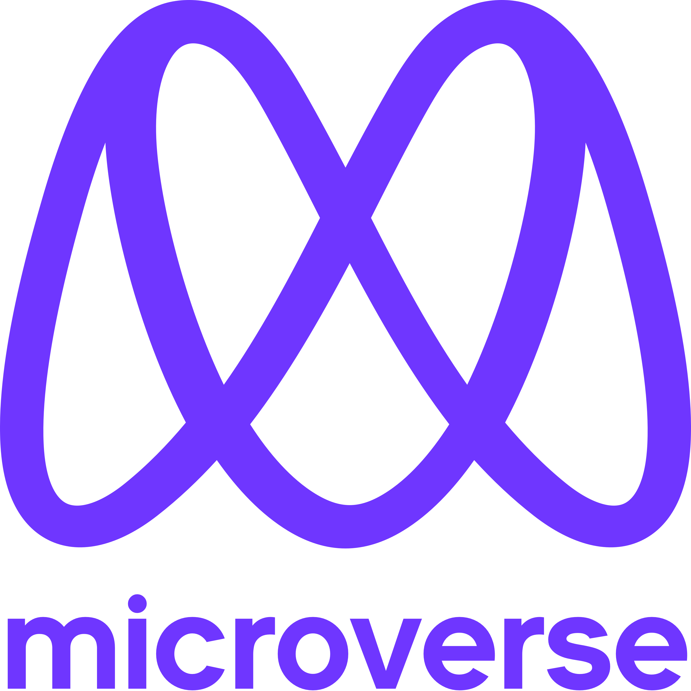

<a name="readme-top"></a>

<div align="center">

  
  <br/> 

</div>

# 📗 Table of Contents

- [📖 About the Project](#about-project)
  - [🛠 Built With](#built-with)
    - [Tech Stack](#tech-stack)
    - [Key Features](#key-features)
  - [🚀 Live Demo](#live-demo)
- [💻 Getting Started](#getting-started)
  - [Setup](#setup)
  - [Prerequisites](#prerequisites)
  - [Install](#install)
  - [Usage](#usage)
  - [Run tests](#run-tests)
  - [Deployment](#triangular_flag_on_post-deployment)
- [👥 Authors](#authors)
- [🔭 Future Features](#future-features)
- [🤝 Contributing](#contributing)
- [⭐️ Show your support](#support)
- [🙏 Acknowledgements](#acknowledgements)
- [❓ FAQ](#faq)
- [📝 License](#license)

# 📖 Pokémon App <a name="about-project"></a>

> Pokémon App is a React and Redux web application to retrieve metrics from the Pokémon API linked to an extensive database detailing everything about the Pokémon main game series.

## 🛠 Built With <a name="built-with"></a>

- Languages: HTML5, CSS3, JavaScript
- Library: React & Redux
- API

### Tech Stack <a name="tech-stack"></a>

<details>
  <summary>Client</summary>
  <ul>
    <li><a href="https://reactjs.org/">React.js</a></li>
  </ul>
</details>

### Key Features <a name="key-features"></a>

- **Fetch API data**
- **Display data items**
- **Display item details**

<p align="right">(<a href="#readme-top">back to top</a>)</p>

## 🚀 Live Demo <a name="live-demo"></a>

- Live [Netlify Link](https://pokemon-web-app-by-mrjay.netlify.app/)
- [Video Demo Link](https://www.loom.com/share/de9c94bfa0bc4c30a837434505cecb23/)

<p align="right">(<a href="#readme-top">back to top</a>)</p>

## 💻 Getting Started <a name="getting-started"></a>

To get a local copy up and running, follow these steps.

### Prerequisites

In order to run this project you need:

- a code editor e.g. [VS Code](https://code.visualstudio.com/) or [Cursor](https://cursor.com/)
- a modern browser e.g. Chrome, Mozilla or Microsoft Edge

### Setup

Clone this repository to your desired folder:

```sh
  cd your-folder
  git@github.com:DJ-MrJay/microverse-capstone-3.git
```

### Install

Install npm:

```sh
  npm install
```

### Usage

To run the project, execute the following command:

```sh
  npm start
```

### Run tests

To run tests, run the following command:

```sh
  npm test
```

### Deployment

You can deploy this project using:

```sh
   npm run build
```

<p align="right">(<a href="#readme-top">back to top</a>)</p>

## 👥 Author <a name="authors"></a>

- GitHub [Link](https://github.com/DJ-MrJay)
- Twitter [Link](https://twitter.com/jonah_wambua)
- LinkedIn [Link](https://www.linkedin.com/in/mr-jay)
- Wellfound [Link](https://angel.co/u/jonah-wambua)

<p align="right">(<a href="#readme-top">back to top</a>)</p>

## 🤝 Contributing <a name="contributing"></a>

Contributions, issues, and feature requests are welcome!

Feel free to check the [issues page](https://github.com/DJ-MrJay/microverse-capstone-3/issues).

<p align="right">(<a href="#readme-top">back to top</a>)</p>

## ⭐️ Show your support <a name="support"></a>

Give a ⭐️ if you like this project!

<p align="right">(<a href="#readme-top">back to top</a>)</p>

## 🙏 Acknowledgments <a name="acknowledgements"></a>

I would like to give special thanks to [Nelson Sakwa on Behance](https://www.behance.net/gallery/31579789/Ballhead-App-%28Free-PSDs%29) for the original design idea.

<p align="right">(<a href="#readme-top">back to top</a>)</p>

## ❓ FAQ <a name="faq"></a>

- **What are the components in React?**

  - A component is essentially a piece of the user interface. It splits the user interface into independent, reusable parts that can be processed separately.

- **What is Redux?**

  - Redux is an open-source, JavaScript library used to manage the application state. React uses Redux to build the user interface.

<p align="right">(<a href="#readme-top">back to top</a>)</p>

## 📝 License <a name="license"></a>

This project is [MIT](./LICENSE) licensed.

<p align="right">(<a href="#readme-top">back to top</a>)</p>
